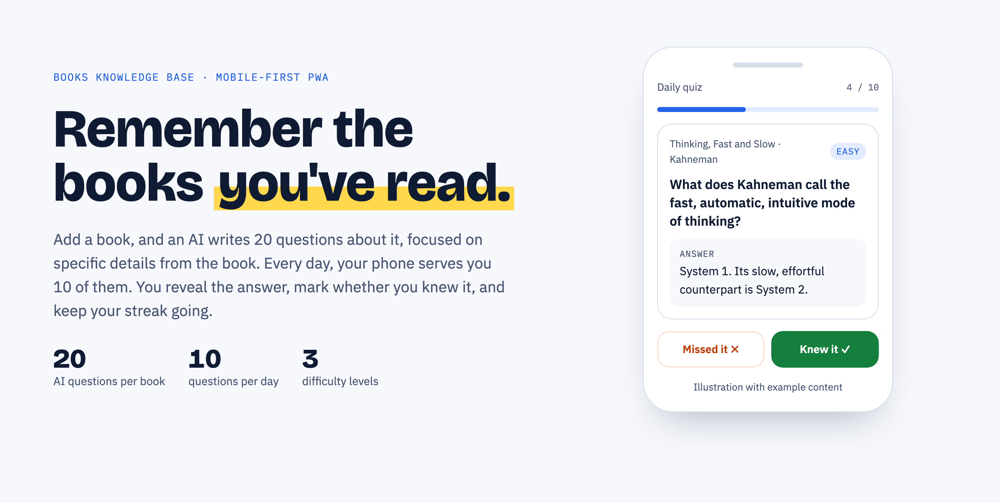
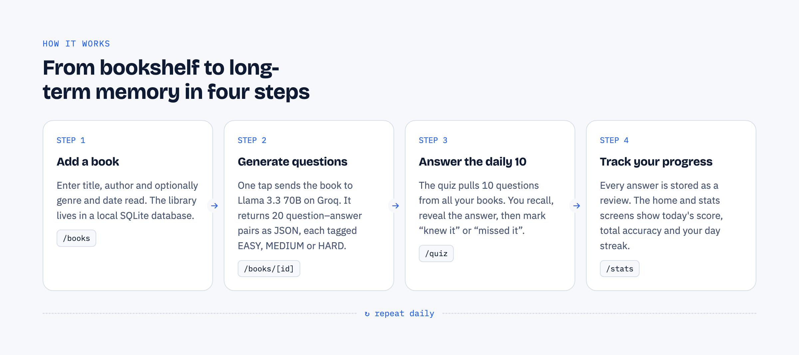

<h1 align="center">Books Knowledge Base</h1>

<p align="center">
  <strong>Turn the books you read into knowledge you keep.</strong><br>
  A mobile-first PWA that uses AI to quiz you on your own books, 10 questions a day.
</p>

<p align="center">
  
  
  
  
  
  
</p>

<picture>
  <source media="(prefers-color-scheme: dark)" srcset="docs/images/hero-dark.png">
  
</picture>

## Why

You finish a book, and a few months later most of it is gone. Books Knowledge Base fixes that with **active recall**: instead of rereading notes, you answer questions about specific details from each book, a little every day.

The AI is instructed to avoid generic questions that anyone could answer without having read the book. Each question asks about something specific: a character's decision, an argument, an experiment, a name or a scene.

## How it works

<picture>
  <source media="(prefers-color-scheme: dark)" srcset="docs/images/how-it-works-dark.png">
  
</picture>

1. **Add a book.** Enter the title and author, plus genre and date read if you like.
2. **Generate questions.** One tap sends the book to Llama 3.3 70B on [Groq](https://groq.com). It returns 20 question–answer pairs, each tagged by difficulty.
3. **Answer the daily 10.** The quiz picks 10 questions from all your books, preferring ones you haven't answered today. Recall the answer, reveal it, then mark *knew it* or *missed it*.
4. **Track your progress.** The home and stats screens show today's score, overall accuracy and your day streak.

| Difficulty | What it asks about |
| --- | --- |
| `EASY` | Concrete facts and characters taken directly from the book |
| `MEDIUM` | Connections and motives between events or characters |
| `HARD` | Easily overlooked details, or links between several parts of the book |

## Features

- 📚 **Library**: add, browse and delete the books you've read
- 🤖 **AI question generation**: 20 book-specific questions per book via Groq
- 🎯 **Daily quiz**: 10 shuffled questions per day across your whole library
- 📈 **Stats**: today's score, total accuracy, questions per book and a daily streak
- 📱 **Installable PWA**: add it to your home screen and it opens like a native app
- 🌙 **Dark mode**: follows your system setting

## Tech stack

| Layer | Technology |
| --- | --- |
| Framework | [Next.js 14](https://nextjs.org) (App Router) |
| Language | TypeScript |
| Styling | [Tailwind CSS](https://tailwindcss.com) |
| Database | SQLite via [Prisma 7](https://www.prisma.io) and the libSQL driver adapter |
| AI | [Groq API](https://console.groq.com/docs) with `llama-3.3-70b-versatile` |
| PWA | [next-pwa](https://github.com/shadowwalker/next-pwa) |

## Getting started

### Prerequisites

- Node.js 20.19 or newer
- A free Groq API key from [console.groq.com/keys](https://console.groq.com/keys)

### Setup

```bash
# 1. Clone and install
git clone https://github.com/jvmyer/Books_knowledge_Base.git
cd Books_knowledge_Base
npm install

# 2. Configure environment variables
cp .env.example .env
# then open .env and paste your Groq API key

# 3. Create the database and generate the Prisma client
npx prisma migrate dev
npx prisma generate

# 4. Start the dev server
npm run dev
```

Open [http://localhost:3000](http://localhost:3000), add your first book, open it and tap **Fragen generieren (KI)**.

> **Note:** The app interface, and the questions the AI generates, are in German.

### Environment variables

| Variable | Required | Description |
| --- | --- | --- |
| `GROQ_API_KEY` | yes | API key used on the server to generate questions |
| `DATABASE_URL` | no | SQLite location, defaults to `file:./prisma/dev.db` |

### Install on your phone

The service worker is disabled in development. To try the installable version:

```bash
npm run build
npm start
```

Then open the app in your phone's browser and choose **Add to Home Screen**. Browsers only offer installation over HTTPS (or on `localhost`), so for daily use deploy the app to a host with HTTPS.

## Project structure

```
app/
├── page.tsx                 Home: today's progress and streak
├── books/                   Library and book detail pages
├── quiz/                    Daily quiz
├── stats/                   Statistics
├── components/BottomNav.tsx Mobile tab bar
└── api/
    ├── books/               Book CRUD and question generation
    └── quiz/                Daily questions, answers, reviews, stats
lib/prisma.ts                Prisma client (libSQL adapter)
prisma/schema.prisma         Data model: Book → Question → DailyReview
public/manifest.json         PWA manifest and icons
```

## API

| Method | Route | Description |
| --- | --- | --- |
| `GET` | `/api/books` | List all books with their question count |
| `POST` | `/api/books` | Add a book (`title` and `author` required) |
| `GET` | `/api/books/[id]` | Get a book with its questions |
| `DELETE` | `/api/books/[id]` | Delete a book, its questions and their reviews |
| `POST` | `/api/books/[id]/generate-questions` | Generate 20 new questions (replaces existing ones) |
| `GET` | `/api/quiz/today` | Today's 10 questions, without answers |
| `GET` | `/api/quiz/answer/[questionId]` | Reveal the answer to one question |
| `POST` | `/api/quiz/review` | Save a result: `{ "questionId": 1, "wasCorrect": true }` |
| `GET` | `/api/quiz/stats` | Today's score, totals and current streak |

## Scripts

| Command | Description |
| --- | --- |
| `npm run dev` | Start the development server |
| `npm run build` | Create a production build (also generates the service worker) |
| `npm start` | Serve the production build |
| `npm run lint` | Run ESLint |
